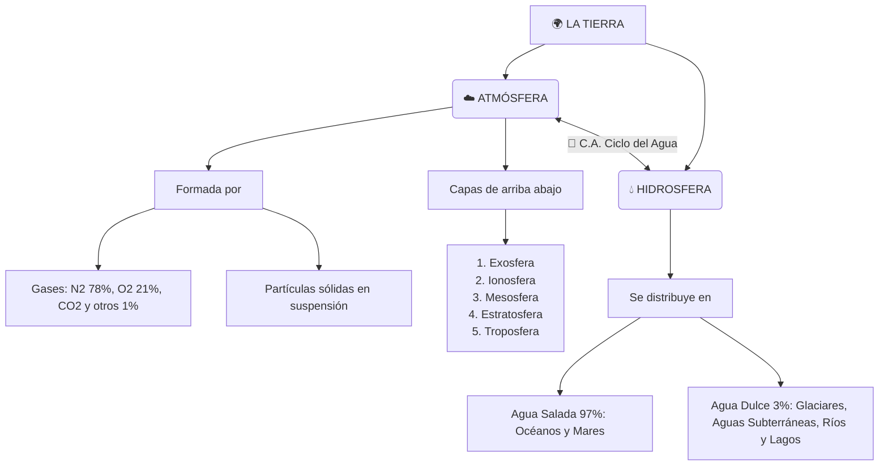

# 🌍 Ficha de Repaso: La Atmósfera y la Hidrosfera (1.º ESO)

> Resumen esquemático, mapa conceptual y autoevaluación para el examen de Biología y Geología.

---

## 🗺️ Mapa Conceptual (Esquema General)

---

## ☁️ 1. La Atmósfera

* **Concepto:** Capa gaseosa que envuelve la Tierra, regula la temperatura y nos protege de las radiaciones solares.
* **Composición:** Mezcla de gases y partículas sólidas en suspensión (polvo, polen, cenizas).
  * **Nitrógeno ($N_2$):** 78 % (el gas más abundante).
  * **Oxígeno ($O_2$):** 21 % (esencial para la respiración).
  * **Otros gases ($CO_2$, vapor de agua, ozono):** 1 %.

### Capas de la Atmósfera (de arriba abajo)
1. **Exosfera:** Capa más externa donde orbitan los satélites artificiales.
2. **Ionosfera (Termosfera):** Se producen las auroras boreales y rebotan las ondas de radio.
3. **Mesosfera:** Capa más fría donde se desintegran los meteoritos (estrellas fugaces).
4. **Estratosfera:** Contiene la **capa de ozono**, que filtra los rayos ultravioleta (UV).
5. **Troposfera:** Capa en contacto con la Tierra donde se desarrolla la vida y ocurren los fenómenos meteorológicos.

---

## 💧 2. El Agua y la Hidrosfera

* **Agua ($H_2O$):** Sustancia líquida, incolora, inodora e insípida indispensable para los seres vivos.
* **Propiedades principales del agua:**
  1. **Gran disolvente:** Transporta nutrientes y sustancias.
  2. **Regulador térmico:** Absorbe y libera calor lentamente, suavizando el clima.
  3. **Anomalía de la densidad:** El hielo pesa menos que el agua líquida y flota (protege la vida acuática en invierno).
* **Hidrosfera:** Conjunto de toda el agua de la Tierra en sus tres estados (sólido, líquido y gaseoso).

---

## 📊 3. Distribución del Agua en la Tierra

| Sigla | Significado | Proporción y Características |
| :--- | :--- | :--- |
| **Oc** | **Océanos** (y mares) | Constituyen la mayor masa de agua del planeta. |
| **AS** | **Agua Salada** | Representa el **97 %** del total. No es apta para el consumo directo. |
| **AD** | **Agua Dulce** | Representa solo el **3 %** del total. Indispensable para la vida terrestre. |
| **AST** | **Aguas Subterráneas** | Se infiltran bajo el suelo formando acuíferos. |
| **Glaciares** | **Glaciares** (y casquetes) | Masas de hielo que forman la mayor reserva de agua dulce. |

> *Nota: El agua dulce superficial también incluye **ríos** y **lagos**.*

---

## 🔄 4. El Ciclo del Agua (`C.A.`)

Proceso continuo que relaciona la **atmósfera** y la **hidrosfera** impulsado por la energía del Sol:

1. **Evaporación:** El agua líquida pasa a vapor de agua y asciende a la atmósfera.
2. **Condensación:** El vapor se enfría en la troposfera y forma las nubes.
3. **Precipitación:** El agua cae a la superficie en forma de lluvia, nieve o granizo.
4. **Escorrentía e infiltración:** El agua regresa al mar por los ríos o se filtra formando aguas subterráneas.

---

## 🧠 5. Autoevaluación Rápida (Haz clic para ver la respuesta)

<b>1. ¿En qué capa de la atmósfera se encuentra la capa de ozono?</b>

 
✅ En la <b>Estratosfera</b>. Protege a los seres vivos de los rayos ultravioleta del Sol.

<b>2. ¿Cuál es el gas más abundante de la atmósfera?</b>

 
✅ El <b>Nitrógeno (N₂)</b>, que representa el <b>78 %</b> del aire.

<b>3. ¿Por qué flota el hielo sobre el agua líquida?</b>

 
✅ Debido a la <b>anomalía de la densidad</b>: al congelarse, el agua aumenta su volumen y se vuelve menos densa que el agua líquida.

<b>4. ¿Dónde se encuentra la mayor reserva de agua dulce del planeta?</b>

 
✅ En los <b>glaciares</b> y casquetes polares (en estado sólido).

<b>5. ¿Qué fase del ciclo del agua forma las nubes?</b>

 
✅ La <b>condensación</b>, cuando el vapor de agua se enfría al subir a la troposfera.

